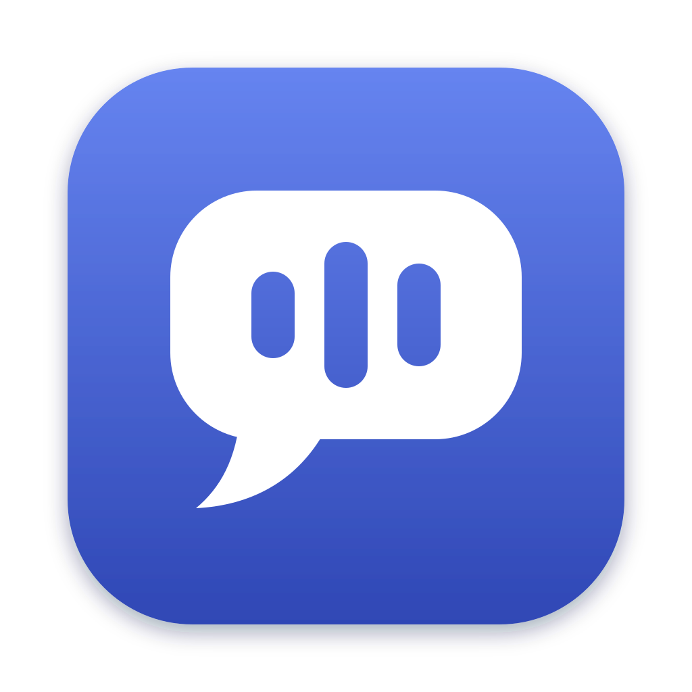

# Glossa

**An invisible speech coach just for you.**

Glossa sits quietly on your screen while you talk — in interviews, meetings,
sales calls, classes, or practice runs — and tells you, live, how you're doing.
It listens only to your microphone, runs entirely on your computer, and never
sends anything anywhere.

> 🌱 **Status: new.** Version 1.0 is the first release, with all five
> features below. Found a rough edge?
> [Open an issue](https://github.com/Shreya20002/glossa/issues/new/choose).

<!-- A short demo GIF goes here. Keep images out of the repo: drag the GIF into
     any GitHub issue or PR comment, then paste the link GitHub gives you here. -->

## What it does

Glossa v1 does five things, and does them well:

| Feature                      | What you see                                                                                                                                            |
| ---------------------------- | ------------------------------------------------------------------------------------------------------------------------------------------------------- |
| 🎙️ **Talk-time meter**       | How much of the session you've spent speaking, plus a "speaking now" dot.                                                                               |
| ⏱️ **Pace**                  | Your words per minute, with a gentle hint when you're rushing or dragging.                                                                              |
| 🔁 **Filler-word counter**   | "um", "uh", "you know", "basically"… counted live, with your top offenders.                                                                             |
| 🗣️ **Monologue alert**       | A soft pulse when you've been talking for over a minute without a break.                                                                                |
| 📋 **Post-call report card** | Each session compared with the last — e.g. _Filler words: 1.6/min, ↓ from 2.6 · better_ — plus your trend. Copy it as an image and share your progress. |

**How accurate is it?** On recordings of real meetings, Glossa catches
**99% of ums and uhs** (96% of what it reports is right). The benchmark is open:
see [eval/README.md](eval/README.md) and run it yourself with `pnpm eval`.

That's it — on purpose. New features get added when users ask for them
(see [Roadmap](#roadmap)).

## Why Glossa is different

- **Private by design.** Your audio never leaves your computer and is never
  saved. Only the numbers on your report card are stored, on your machine.
- **Works offline.** The speech models ship inside the app. No account, no API
  key, no internet connection required.
- **Invisible to others.** The overlay is hidden from screen sharing on
  operating systems that support it, so only you see your coach.
- **Mic-only.** No meeting-app plugins or system audio hacks — it works the same
  with Zoom, Meet, Teams, a phone call, or no call at all.
- **Free and open source.** Apache-2.0 licensed. No subscription, ever.

## Install

Download the installer for your computer from the
[latest release](https://github.com/Shreya20002/glossa/releases/latest):

| Your computer                                       | Download                     |
| --------------------------------------------------- | ---------------------------- |
| **Windows** 10 or 11 (64-bit)                       | `Glossa-<version>-setup.exe` |
| **Mac** with Apple Silicon (M1 or newer), macOS 13+ | `Glossa-<version>-arm64.dmg` |

Intel Macs aren't supported: the speech engine Glossa uses has no Intel build.

**Why your computer warns you, and what to do.** Operating systems fully trust
apps that are signed with a paid certificate. Glossa is free and has no budget
for one, so you'll see a warning the first time you open it. Every installer is
built by GitHub from the public source code of a tagged release, and you can
read [exactly how](.github/workflows/release.yml).

- **Windows:** run the installer. If you see _"Windows protected your PC"_,
  click **More info**, then **Run anyway**. Glossa installs just for you (no
  admin password) and opens. If it can't hear you, turn on **Settings →
  Privacy & security → Microphone → Let desktop apps access your microphone**.
- **Mac:** open the `.dmg` and drag **Glossa** into **Applications**, then open
  it. macOS says it can't verify Glossa: click **Done**, open **System Settings
  → Privacy & Security**, scroll down, click **Open Anyway** next to the
  message about Glossa, and confirm. (On macOS 13 or 14 you can instead
  Control-click Glossa in Applications and choose **Open**.) Then allow
  microphone access when asked.

You only do this once. Glossa never checks for updates (it never goes online);
to hear about new versions, click **Watch → Custom → Releases** on this page.

**Uninstalling:** on Windows, use **Settings → Apps → Installed apps**; on a
Mac, drag Glossa from Applications to the Trash. Your session history stays in
`%APPDATA%\Glossa` or `~/Library/Application Support/Glossa` until you delete
that folder.

**Tip:** use headphones. Glossa measures _your_ voice from your microphone; if
the other people on your call come out of your speakers, the mic hears them too.

## Roadmap

Glossa v1 is deliberately small. Ideas that are **not in v1 (yet)**:

- Ghost notes (private talking points on the overlay)
- Agenda timer
- Two-sided talk ratio using system audio
- Custom filler-word lists and other languages
- More settings (pace targets, monologue length)

Want one of these, or something else? Upvote an existing
[feature request](https://github.com/Shreya20002/glossa/issues?q=is%3Aissue+label%3Aenhancement)
or open a new one. The most-requested ideas get built next.

## Contributing

Contributions of all sizes are welcome — bug reports, docs, filler words from
your dialect, test recordings, and code. Start with
[CONTRIBUTING.md](CONTRIBUTING.md). Everyone taking part agrees to our
[Code of Conduct](CODE_OF_CONDUCT.md).

Curious how it works? See [docs/architecture.md](docs/architecture.md) and
[docs/privacy.md](docs/privacy.md).

Found a security problem? Please report it privately — see [SECURITY.md](SECURITY.md).

## License

Glossa is licensed under the [Apache License 2.0](LICENSE).

_The name: γλῶσσα (glôssa) is Ancient Greek for "tongue" and "language"._
